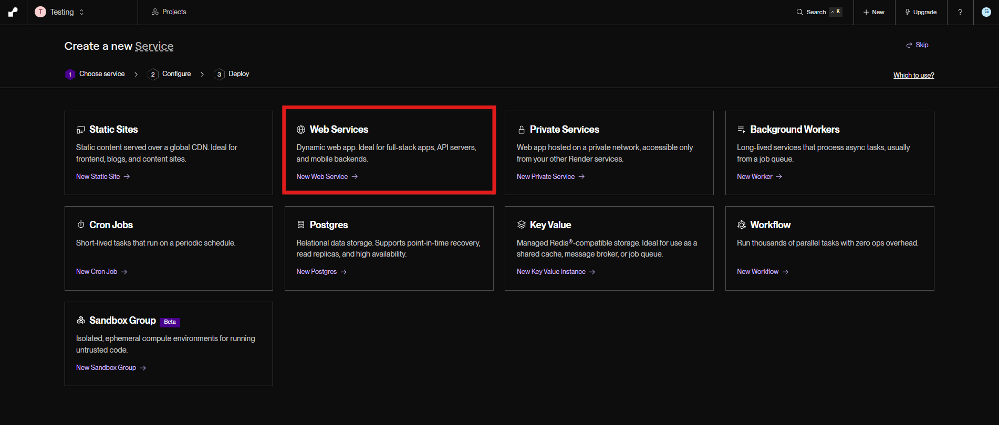
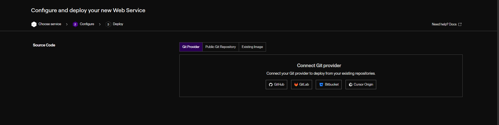
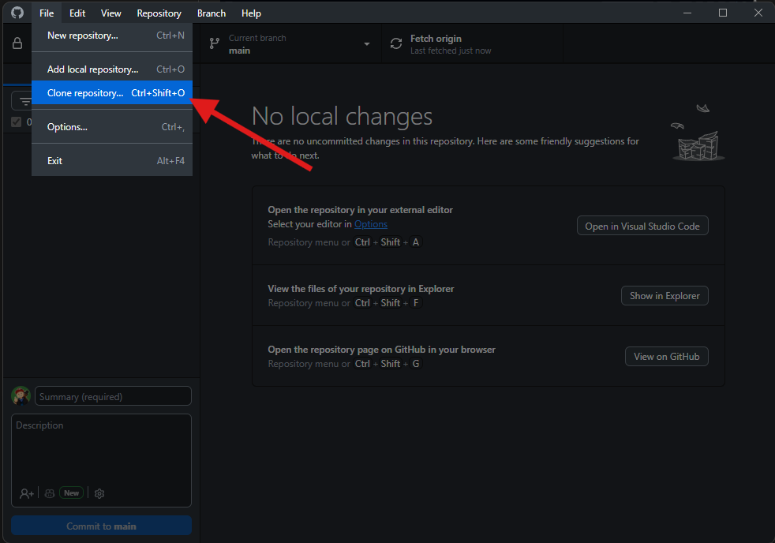
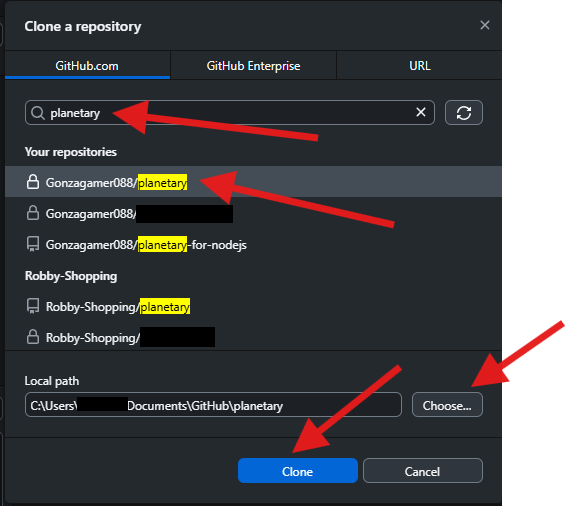
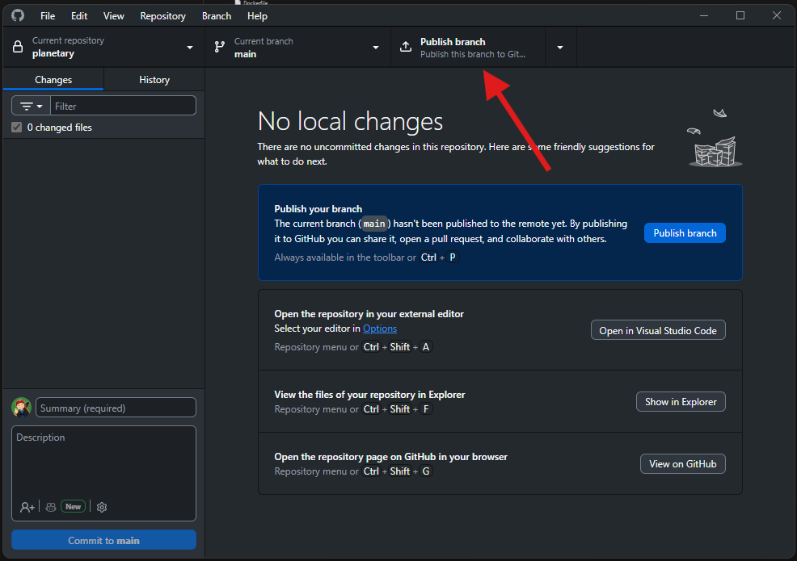

## Overview

Render is ideal for developers that want full ownership of their data, more customisation, preview deployments and even more. This guide will help you to set up your Render instance and start running your own deployment today.

<Info>
  You might need some experience with database setup and knowledge of the Render infrastructures and dashboard.
</Info>

## Requisites

- A [Render](https://dashboard.render.com/register) account
- A [GitHub](https://github.com/signup) account
- The [GitHub Desktop](https://github.com/apps/desktop) app (Available for <u>Windows</u> and <u>Mac</u>)
- A PostgreSQL database

## Recommended Database Hosting

<table>
  <colgroup>
    <col width="115" />
    <col width="300" />
  </colgroup>
  <thead>
    <tr>
      <th>Hosting</th>
      <th>Why</th>
    </tr>
  </thead>
  <tbody>
    <tr>
      <td>[Aiven](https://aiven.io)</td>
      <td>It has a free tier for a single database deployment with no limit for CU hours.</td>
    </tr>
    <tr>
      <td>[Layerbase](https://layerbase.com)</td>
      <td>It has a free tier for 2 database deployments with no limit for CU hours.</td>
    </tr>
  </tbody>
</table>

## Unrecommended Database Hosting

<table>
  <colgroup>
    <col width="124" />
    <col width="511" />
  </colgroup>
  <thead>
    <tr>
      <th>Hosting</th>
      <th>Why</th>
    </tr>
  </thead>
  <tbody>
    <tr>
      <td>[Neon](https://neon.tech)</td>
      <td>It has a limit of 100 CU, which, if you have a normal use of the instance, you will run out of these fast, and your instance will stop working</td>
    </tr>
    <tr>
      <td>[Supabase](https://supabase.com/)</td>
      <td>It only allows connections from IPv6 IP adresses which Render may not give you for free, making it impossible for the instance to connect to the database.</td>
    </tr>
  </tbody>
</table>

# Setup

<Steps>
  <Step title="Create a Render Account and the Workspace">
    Go to [the Render dashboard](https://dashboard.render.com/register) and create a new workspace if you don't have one. Choose the free tier in order to have your free instance.

    
  </Step>
  <Step title="Create the project">
    Once you create the workspace, choose the option called **Web Services**.

    

    You will find then this page:

    

    Choose GitHub and link your GitHub account.
  </Step>
  <Step title="Creating the GitHub repo and uploading the files">
    Go to the official Planetary repository and download the latest release from the **Releases** section. You can see the latest one [here](https://github.com/PlanetaryOrbit/orbit/releases).

    Once you download it, create a new repository under **your profile** (not under an organisation, or you will have to keep it public) and keep it private.

    

    Once you create it, open the GitHub Desktop app and clone the repository you just created in the folder that you prefer.

    

    

    Once you did that, upload the files you just downloaded from the Orbit repository, unzip them, and place them like this:

    

    Go back to the GitHub Desktop app and in Summary input something like **Upload** or something random. Then click "<u>Commit</u>".

    

    Once you do the local commit, click on Publish Branch.

    
  </Step>
</Steps>
