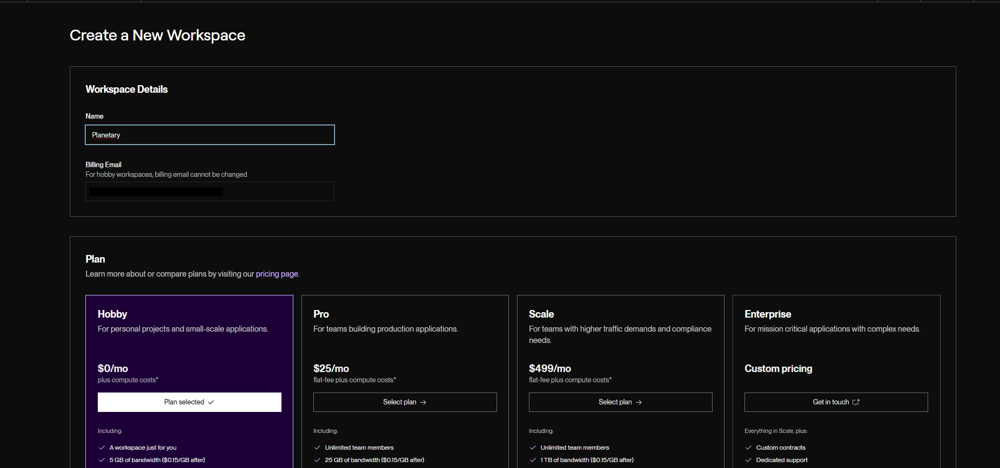
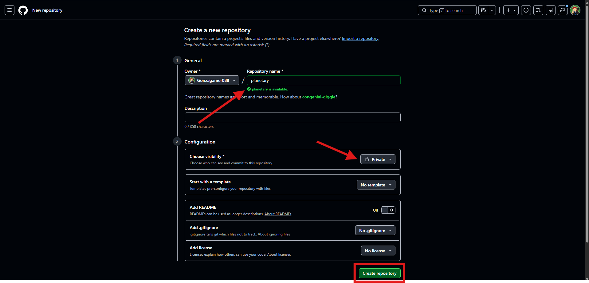
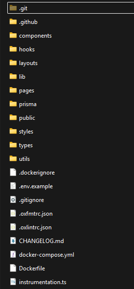
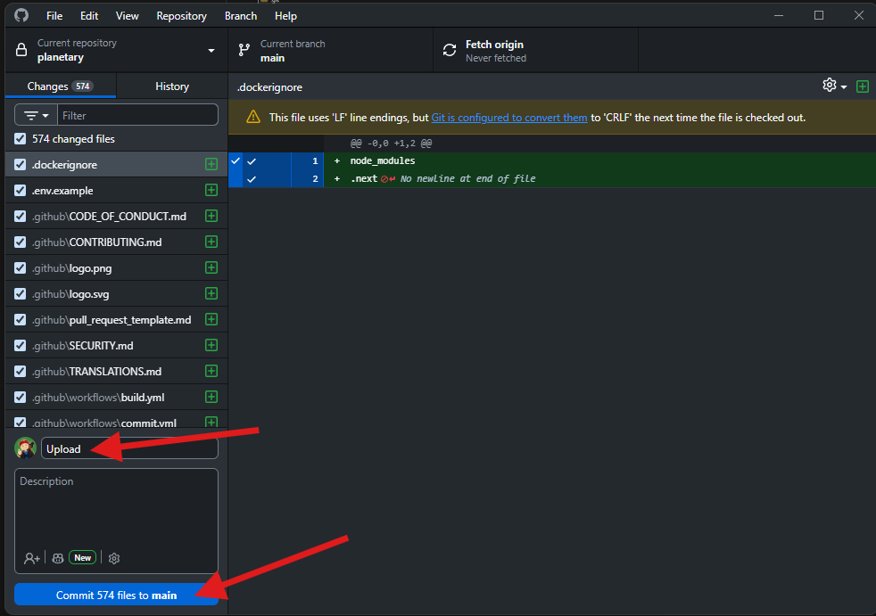
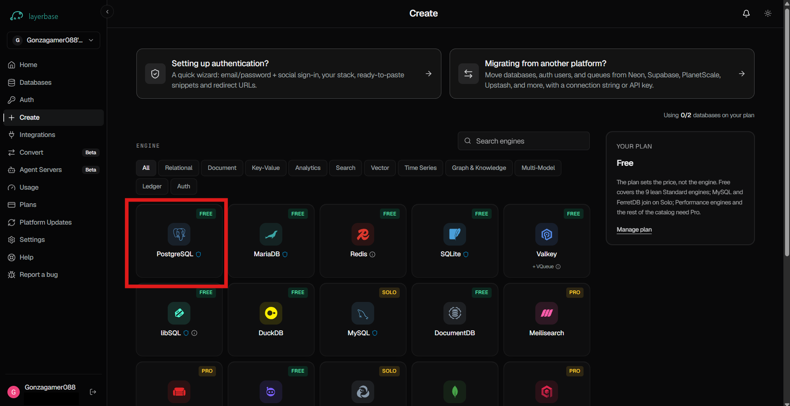
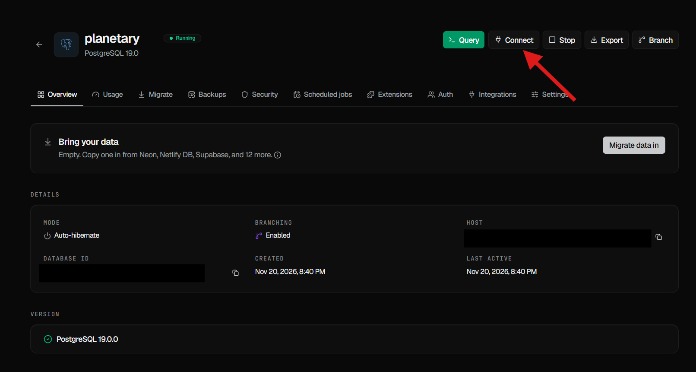
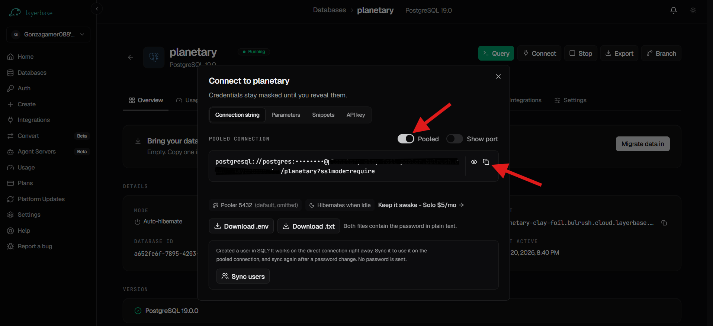
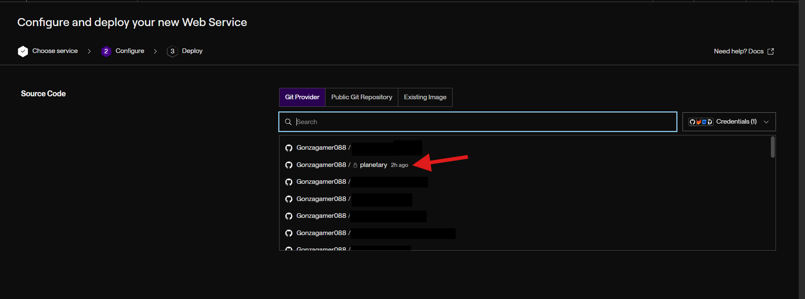

## Overview

Render is ideal for developers that want full ownership of their data, more customisation, preview deployments and even more. This guide will help you to set up your Render instance and start running your own deployment today.

<Info>
  You might need some experience with database setup and knowledge of the Render infrastructures and dashboard.
</Info>

## Requisites

- A [Render](https://dashboard.render.com/register) account
- A [GitHub](https://github.com/signup) account
- The [GitHub Desktop](https://github.com/apps/desktop) app (Available for <u>Windows</u> and <u>Mac</u>)
- A PostgreSQL database

## Recommended Database Hosting

<table>
  <colgroup>
    <col width="115" />
    <col width="300" />
  </colgroup>
  <thead>
    <tr>
      <th>Hosting</th>
      <th>Why</th>
    </tr>
  </thead>
  <tbody>
    <tr>
      <td>[Aiven](https://aiven.io)</td>
      <td>It has a free tier for a single database deployment with no limit for CU hours.</td>
    </tr>
    <tr>
      <td>[Layerbase](https://layerbase.com)</td>
      <td>It has a free tier for 2 database deployments with no limit for CU hours.</td>
    </tr>
  </tbody>
</table>

## Unrecommended Database Hosting

<table>
  <colgroup>
    <col width="124" />
    <col width="511" />
  </colgroup>
  <thead>
    <tr>
      <th>Hosting</th>
      <th>Why</th>
    </tr>
  </thead>
  <tbody>
    <tr>
      <td>[Neon](https://neon.tech)</td>
      <td>It has a limit of 100 CU, which, if you have a normal use of the instance, you will run out of these fast, and your instance will stop working</td>
    </tr>
    <tr>
      <td>[Supabase](https://supabase.com/)</td>
      <td>It only allows connections from IPv6 IP adresses which Render may not give you for free, making it impossible for the instance to connect to the database.</td>
    </tr>
  </tbody>
</table>

# Setup

<Steps>
  <Step title="Create a Render Account and the Workspace">
    Go to [the Render dashboard](https://dashboard.render.com/register) and create a new workspace if you don't have one. Choose the free tier in order to have your free instance.

    
  </Step>
  <Step title="Create the project">
    Once you create the workspace, choose the option called **Web Services**.

    

    You will find this page:

    

    Choose GitHub and link your GitHub account.
  </Step>
  <Step title="Creating the GitHub repo and uploading the files">
    Go to the official Planetary repository and download the latest release from the **Releases** section. You can see the latest one [here](https://github.com/PlanetaryOrbit/orbit/releases).

    Once you download it, create a new repository under **your profile** (not under an organisation, or you will have to keep it public) and keep it private.

    

    After you created it, open the GitHub Desktop app and clone the repository you just created in the folder that you prefer.

    

    

    Once you did that, upload the files you just downloaded from the Orbit repository, unzip them, and place them like this:

    

    Go back to the GitHub Desktop app, and in the Summary input something like **'Upload'** or something random. Then click "<u>Commit</u>".

    

    After you do the local commit, click on Publish Branch.

    

    When you end all the steps mentioned before, you will have all the necessary files to run Orbit in your Render instance.
  </Step>
  <Step title="Setup the Database">
    Setup the database in your preferred hosting. We recommend using one of the hostings suggested on the [recommended database hosting services](/deploying-with-render#recommended-database-hosting). For this guide, we'll be using [Layerbase](https://layerbase.com/).

    Create an account and head to the dashboard. Once there, click on 'New Database' and select PostgreSQL in the menu.

    

    Set the database name to anything you want, and make sure that the version selected is the latest stable one. You may also set a region for the database, which I recommend setting to US, as most of the available machines for Render hosting are in the US.

    After you create the database, click on 'Connect' and copy the connection string it gives you. Make sure that 'Pooled' is enabled to make sure all changes are applied to the database. 

    

    

    Paste this connection string to a notepad, or come back to this page when you need to paste it.
  </Step>
  <Step title="Linking the repository to the instance">
    Once you created the repository, uploaded the files and linked your GitHub account to your Render account/workspace, click on the repo you just created to link it to the instance.

    

    Once you clicked the repository, you will see a setup screen. Set the following variables:

    - Name: Any name you want to give to your instance (Default: Planetary)
    - Language: `Node`
    - Branch: `main`
    - Region: the nearest to the database you just created
    - Build Command: 
      ```text
      pnpm install --frozen-lockfile && pnpm exec prisma generate
      ```
    - Start Command: 
      ```text
      pnpm exec prisma migrate deploy && pnpm start
      ```
    - Compute: \$0 / month (This is the Free Tier for their instances)
    - Environment Variables: Refer to Environment Variables.
  </Step>
  <Step title="Start the instance">
    Click on Deploy and check for any errors in the build logs. If it fails, refer to Troubleshooting in order to fix the errors.
  </Step>
</Steps>
